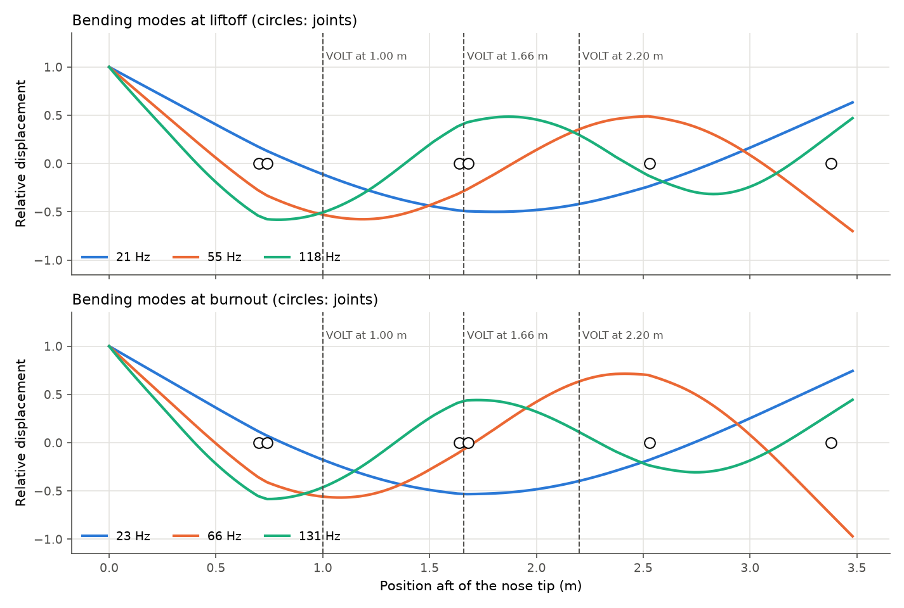
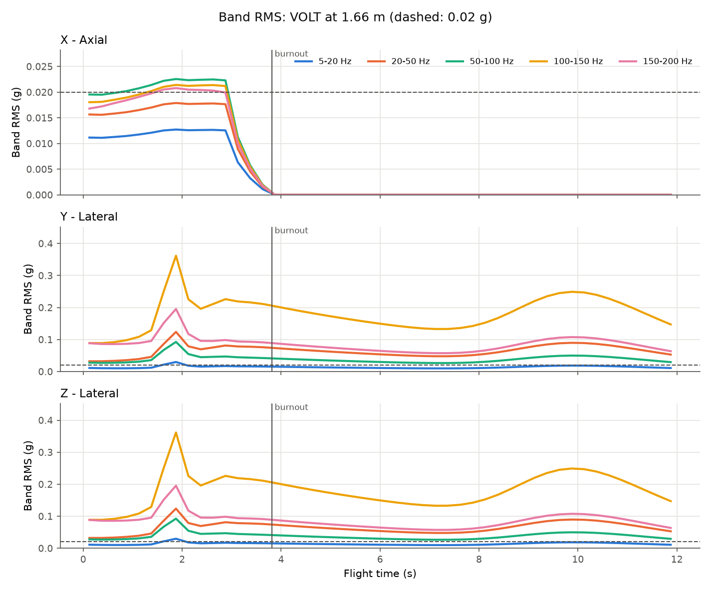

# VOLT: predicted flight vibration and harvestable energy

*Preliminary, for team review. 14 November 2026.*

VOLT will fly piezoelectric cantilevers tuned to different frequencies in our
IREC 30k COTS rocket. This note predicts the vibration VOLT will sit in,
**which frequencies are worth tuning to, where in the rocket VOLT should go,
and roughly how much energy a harvester can collect**, so we can make those
choices before we have flight data. It also explains how the numbers were made
and how far to trust them.

VOLT's position, mounting and harvester designs aren't decided yet, so this
looks at several candidate positions and a generic harvester rather than our
actual one.

---

## Summary

1. **Tune to the airframe's bending modes.** Sideways (lateral) vibration piles
   up at three frequencies, near **21-23 Hz, 54-66 Hz and 112-131 Hz**. Between
   them there is much less to harvest.
2. **These frequencies drift up during the burn**, by 12-20%, as the motor
   burns off 9-10 kg of propellant. A sharply tuned harvester is only on
   resonance for part of the boost.
3. **Where VOLT sits decides which modes it feels.** Each mode has points
   along the rocket that barely move. At 1.66 m (where the design's 2 kg
   placeholder mass is) the 60 Hz mode almost vanishes; at 1.0 m the 22 Hz
   mode almost vanishes. No single spot gets all three.
4. **Expect millijoules, not joules.** A harvester with a 5 g effective tip mass
   tuned to a mode collects roughly **0.2-3.7 mJ** between ignition and apogee,
   with peaks of about **0.3-1 mW** for a second or two. Real numbers could be
   10 times higher or lower than these. The load VOLT must "reliably power"
   should be sized for microwatts on average.
5. **The strongest vibration comes when the rocket passes Mach 1**, about 1.6-1.9 s
   after ignition, and again when it slows back through Mach 1 in coast (about
   10 s). Coast contributes about as much energy as the boost because it lasts
   much longer.

---

## The flight assumed

The rocket is `IREC_2027_Prelim.ork`, imported as it stands: 6" fiberglass
airframe, 3.48 m long, 98 mm motor mount, dry mass 18.3 kg. It was flown in
Apogee from Spaceport America (1,401 m elevation, 5.18 m rail at 86°, standard
atmosphere, no wind) on both motors the design lists:

| | Loki N5500LW | AeroTech O5500X-PS |
|---|---|---|
| Mass at liftoff | 33.1 kg | 35.0 kg |
| Burnout | 3.8 s | 4.0 s |
| Mach 1 | 1.8 s | 1.6 s |
| Max dynamic pressure | 158 kPa at 3.3 s | 170 kPa at 3.4 s |
| Max Mach | 1.73 | 1.82 |
| Apogee | 7,490 m AGL at 35.6 s | 8,390 m AGL at 37.5 s |

Thrust curves are ThrustCurve.org's certification data.

> **Please check the .ork before relying on any of this:** it has two shock
> cords of 10.5 m of 3/4" Kevlar at 0.35 kg/m, which is **3.67 kg each** (7.3
> kg of the 18.3 kg dry mass). That looks like the wrong cord. Fixing it will
> raise the mode frequencies and move the still points, so every number below
> will shift.

---

## How the numbers were made

The tool is in Apogee (`packages/simcore/src/simcore/structures/`); the full
method is in `docs/methods/vibration.md`. In brief:

### 1. The airframe as a free beam

The rocket is modelled as a beam with nothing holding it (true in flight), cut
into 160 short pieces from nose tip to tail. From the .ork it takes:

- **every tube** (body tubes, couplers, motor tube, nose cone): radius, wall
  thickness, and the material's stiffness in bending (Young's modulus, 17 GPa
  for filament-wound fiberglass) and in shear (5 GPa). Couplers add their
  stiffness to the tubes they sit in.
- **every part's mass**, at its position, so mass and centre of gravity
  match OpenRocket's.
- **the joints** between sections, each made a little floppier than solid tube.
- **the motor**, whose propellant burns off as the impulse is delivered.

Solving the beam gives its **modes**: the frequencies it naturally rings at,
and each one's shape along the rocket. Because the motor loses mass, the modes
are re-solved every 0.25 s through the flight.

*Why a beam:* a rocket is long and thin (about 23 calibers here), so its
low-frequency vibration is dominated by the whole airframe bending like a
beam. Finite-element models of this kind are the standard first analysis for
launch vehicles.

### 2. What shakes it

Three random forces, each scaled to the flight at that moment:

- **Motor roughness**: thrust isn't perfectly smooth; it fluctuates by a
  fraction of a percent, pushing the rocket lengthwise (axial).
- **Motor side load**: a small sideways force at the nozzle.
- **Air turbulence**: random sideways pressure along the airframe and fins,
  proportional to dynamic pressure (q = ½ρv²). It is made stronger around
  Mach 1, where shock waves move along the rocket. This dominates VOLT's
  environment once the rocket is fast.

### 3. The response

Each mode responds to the forces most strongly near its own frequency. Adding
up the modes gives the vibration spectrum at any point on the rocket, window
by window. From that come the same plots our MATLAB analysis of Lanius made:
the spectrum, band RMS over time, and how often each band is above a threshold.

### 4. Calibration against our own flights

The model has a few numbers that can't be worked out from first principles:
how floppy the joints are, and how strong each source of shaking is. These
were fitted to real flight data from two of our rockets:

| | First bending mode, predicted | Measured |
|---|---|---|
| **Lanius** (6", 3.25 m, M1340W) | 33.7-34.9 Hz | ~33 Hz (the MATLAB analysis of its flight computer data) |
| **Luke** (5", 2.25 m, K940) | 48.1-49.5 Hz | 48-50 Hz (Luke's Blue Raven log) |

One joint setting matches both rockets to within 2-5%. After fitting the
three force strengths to Luke's log, predicted and measured vibration in each
frequency band agree to a median of 3.5 dB (about 1.5x in RMS). That is about
as close as the measurements themselves scatter from one quarter-second to the
next.

*Note:* the two Luke log files in our data folder (J760 and K940) contain
identical accelerometer readings, so only one Luke flight was actually
available. Whoever has the original logs, please check.

### 5. Harvested energy

A cantilever harvester behaves like a mass on a spring. For a mass on a spring
shaken by broadband vibration, the average power it absorbs has a simple
standard result:

    P ≈ m × G(fₙ) / 4

- **m**: the harvester's effective (tip) mass, in kg;
- **G(fₙ)**: the vibration's power spectral density at the harvester's
  resonant frequency fₙ, in (m/s²)²/Hz.

Only part of that power goes to the electrical load; the rest is lost in the
beam's own mechanical damping. When the electrical damping equals the
mechanical damping (a well-matched load), the load gets half. So:

    P_harvested ≈ ½ × m × G(fₙ) / 4

Power was worked out every 0.25 s and added up from ignition to apogee. Figures
below use a **5 g effective tip mass**; energy is proportional to the tip mass,
so double the mass doubles the energy.

*Why this formula:* it needs no details of the beam or piezo material we
haven't chosen yet. It is accurate when the harvester's resonance is narrower
than the airframe's. A harvester with 2% damping has a bandwidth of about 0.9 Hz
at 22 Hz; the airframe mode is about 1.8 Hz wide, so that holds roughly. Once
we have real harvester designs, a proper electromechanical model will
replace it.

---

## Predictions

### Frequencies to tune to

| Mode | N5500LW, liftoff → burnout | O5500X, liftoff → burnout | Drift |
|---|---|---|---|
| 1st bending | 20.8 → 23.4 Hz | 20.1 → 22.8 Hz | +12% |
| 2nd bending | 54.5 → 66.1 Hz | 53.9 → 63.9 Hz | +20% |
| 3rd bending | 118 → 132 Hz | 112 → 128 Hz | +11% |
| 1st axial | 203 → 235 Hz | 202 → 231 Hz | |

The first axial mode is above most of VOLT's likely range. Lengthwise vibration
below about 200 Hz is the whole rocket being pushed back and forth by thrust
roughness, flat across frequency, with no peaks to tune to.



*Mode shapes at liftoff and burnout. Where a curve crosses zero, that mode
doesn't move the airframe; a harvester there won't feel it. Circles are
joints.*

### Where VOLT sits: energy per harvester, ignition to apogee

5 g tip mass, matched load, harvester tuned to the frequency shown.

**N5500LW**

| VOLT position (aft of nose tip) | 22 Hz | 60 Hz | 125 Hz | Strongest lateral vibration |
|---|---|---|---|---|
| 0.40 m (nose bay) | 0.43 mJ | 0.06 mJ | 0.01 mJ | 0.21 g RMS |
| 1.00 m | 0.04 mJ | 0.29 mJ | **1.05 mJ** | 0.55 g RMS |
| 1.66 m (2 kg placeholder) | **0.44 mJ** | 0.04 mJ | 0.89 mJ | 0.49 g RMS |
| 2.20 m | 0.28 mJ | **0.28 mJ** | 0.14 mJ | 0.53 g RMS |
| 2.90 m (fin can) | 0.04 mJ | 0.08 mJ | 0.36 mJ | 0.49 g RMS |

**O5500X-PS**

| VOLT position | 22 Hz | 60 Hz | 125 Hz | Strongest lateral vibration |
|---|---|---|---|---|
| 0.40 m | 1.60 mJ | 0.20 mJ | 0.03 mJ | 0.35 g RMS |
| 1.00 m | 0.14 mJ | 1.06 mJ | **3.67 mJ** | 0.90 g RMS |
| 1.66 m | **1.58 mJ** | 0.13 mJ | 2.91 mJ | 0.81 g RMS |
| 2.20 m | 0.97 mJ | **0.93 mJ** | 0.37 mJ | 0.77 g RMS |
| 2.90 m | 0.15 mJ | 0.24 mJ | 1.40 mJ | 0.76 g RMS |

Peak harvested power is about 0.3-0.7 mW (N5500LW) and 0.5-1 mW (O5500X), at
the Mach 1 crossing. The O-motor gives about three times the energy: it is
faster, so the air shakes the rocket harder, and it passes Mach 1 sooner.

**What the tables say about position:**

- **2.20 m is the most even across the three modes**: it is clear of the 22
  and 60 Hz still points, though close to a 125 Hz still point by burnout, so
  the 125 Hz harvester gets less there. If the experiment is "does a spread of
  frequencies capture more energy", this is the fairest of the candidates.
- **1.66 m gets the 22 Hz and 125 Hz modes but almost none of the 60 Hz mode**
  (it sits on that mode's still point at burnout). That could be useful as a
  built-in control: a 60 Hz harvester there *should* collect very little, and
  that's a prediction we can test.
- **1.00 m is best for the high modes** and worst for the first.
- These positions will move when the shock cord masses are fixed, and with
  VOLT's own 2-3 kg added. Re-run once both are known.

### When it happens



*Vibration in each frequency band through the first 12 s, at 1.66 m, on the
N5500LW. Lateral (Y, Z) is identical by symmetry in the model; in flight the
two axes will differ.*

- **Boost (0-3.8 s):** builds up with speed and peaks at Mach 1 (1.8 s). Axial
  vibration stops at burnout.
- **Coast:** stays high while the rocket is fast, rises again when it slows back
  through Mach 1 (about 10 s), then fades as the air thins and the rocket slows.
- Roughly half of each harvester's energy comes during coast.

Figures for every candidate position and both motors are in `figures/`:
`modes.png`, and per position `-spectrum.png`, `-bands.png` and
`-persistence.png`.

---

## How far to trust this

| Prediction | Confidence | Why |
|---|---|---|
| 1st bending mode frequency | **±5%** | Matched on two of our rockets |
| 2nd and 3rd mode frequencies | **±15-25%** | On Lanius and Luke the higher modes missed by this much |
| Mode drift during the burn | Good | It's just the motor's mass, which we know |
| Which positions are still points | Fair | Moves with the modes; check with a tap test |
| Lateral vibration level | **Within ~10x** | Calibrated on Luke at up to 25 kPa and Mach 0.6; this rocket reaches 160-170 kPa and Mach 1.8. On Lanius at higher q the model read 2-4x high, so these are more likely too high than too low |
| Axial vibration level | Poor | Thrust roughness depends on the propellant. The calibration motor was a K940; Lanius's M1340W (White Lightning) was 4-7x rougher. The N5500LW is also a white propellant, so axial may be several times higher than shown |
| Harvested energy | **Within ~10x** | Proportional to the vibration level |

Not modelled at all:

- **VOLT's own mounting.** The CubeSat frame and its attachment to the
  airframe have their own resonances, which amplify some frequencies and cut
  others before they reach the harvesters. This could matter as much as
  anything above.
- **Shocks**: ignition, rail exit, burnout, separation, parachute opening,
  landing. These are short jolts, not steady vibration, and could be large.
- **Rocket pitching and coning** below about 20 Hz.

---

## Recommendations

1. **Tune harvesters to the three bending modes**, around 22, 60 and 125 Hz,
   and consider making some deliberately broadband (more damping), since the
   modes drift 12-20% during the burn. Pairs at the same mode, one sharp and
   one broad, would test whether bandwidth or Q wins in flight.
2. **Consider one harvester tuned between modes** (e.g. 40 Hz or 90 Hz) as a
   control: the model says it should collect little.
3. **Pick VOLT's position with the mode shapes in mind.** 2.20 m is the most
   even across modes; 1.66 m loses the 60 Hz mode.
4. **Size the "pre-determined load" for microwatts on average**: something
   that runs off a capacitor charged over the flight (a duty-cycled sensor
   reading, an LED pulse) rather than anything drawing continuously.
5. **Put an accelerometer right at the harvester mount**, not just on the
   CubeSat. Without it we can't tell harvester performance apart from what the
   mount did to the vibration.
6. **Log at 1 kHz or more with an anti-aliasing filter**, so the 125 Hz mode
   is captured cleanly and nothing higher folds down into the bands we care
   about.
7. **Tap-test the airframe** once it's built, with VOLT (or a mass dummy) in
   place: hang it horizontally on two bungees, tap it sideways, record the
   ring-down, FFT it. That gives the real mode frequencies to within a few
   percent before we finalise the tuning. Steps are in
   `docs/methods/vibration.md`.
8. **Fix the shock cords in the .ork and re-run** this once VOLT's position
   and mass are known.

VOLT's own flight data will also be the best check this model has had. It
will let us tighten the predictions for future rockets and payloads.

---

## What we need next

- VOLT's position in the rocket, mass, and how it mounts.
- The harvester designs: beam size, tip mass, piezo material, target
  frequency and damping.
- A corrected .ork (shock cords).
- If anyone has it: the raw Lanius flight computer CSV, which would let us
  calibrate thrust roughness for a white-propellant motor like the N5500LW.

With harvester designs, the tool can be extended to predict each harvester's
voltage and energy over the flight directly, for comparison with the shaker
tests.

---

## Reproducing this

From the Apogee repo:

```
uv run python scripts/vibration_report.py MISSION.apg --ork "data/OpenRocket Models/IREC_2027_Prelim.ork" -o OUT
```

The mission bundles used here were built from the .ork, the ThrustCurve.org
curves for the N5500LW and O5500X-PS, and Spaceport America as the site, with
stations added at the candidate positions. The energy estimate is the formula
in section 5 applied to the predicted lateral spectrum at each station.
